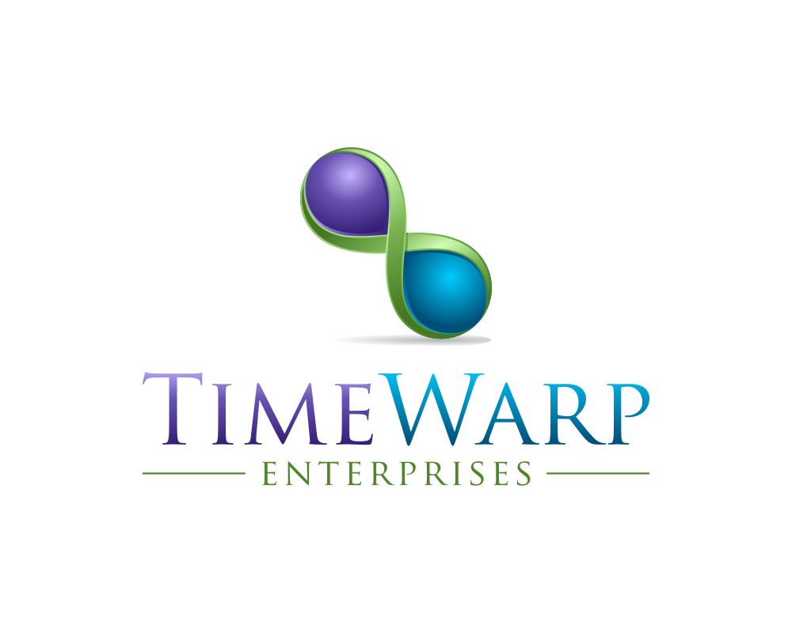
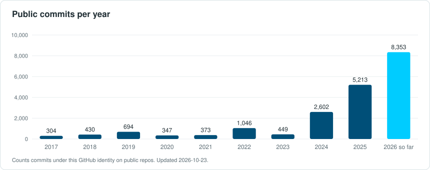

  

<h3 align="center"><a href="https://timewarp.software">I build .NET tools for people and agents</a></h3>

Timewarp Software is where people and agents find the .NET tools and skills.

## Find the work

- [Timewarp Engineering](https://github.com/TimeWarpEngineering)
- [Timewarp Software](https://timewarp.software)
- [Timewarp Enterprises](https://timewarp.enterprises)

## What I'm building

<!-- REPOS:START -->
| Repo | What it is | Stars | Latest release |
| --- | --- | ---: | --- |
| [timewarp-state](https://github.com/TimeWarpEngineering/timewarp-state) | A Blazor State management library by TimeWarp. | 611 | v12.0.0-beta.15 |
| [timewarp-nuru](https://github.com/TimeWarpEngineering/timewarp-nuru) | Route-based CLI framework for .NET - Nuru means 'light' in Swahili | 121 | v4.0.0-beta.5 |
| [timewarp-architecture](https://github.com/TimeWarpEngineering/timewarp-architecture) | A distributed application template for dotnet. Utilizing Blazor, Web API, gRPC, Tye, YARP etc. | 55 | v2.0.0-beta.27 |
| [timewarp-amuru](https://github.com/TimeWarpEngineering/timewarp-amuru) | Fluent C# process execution with pipeline support, a replacement for System.Diagnostics.Process. | 19 | v2.0.0 |
| [timewarp-terminal](https://github.com/TimeWarpEngineering/timewarp-terminal) | A testable console and output layer for any .NET CLI: IConsole, ITerminal, panels, tables, rules and ANSI color. | 2 | v1.0.2 |
| [timewarp-mediator](https://github.com/TimeWarpEngineering/timewarp-mediator) | Simple, unambitious mediator implementation in .NET | 16 | v15.0.0-beta.1 |
| [timewarp-jaribu](https://github.com/TimeWarpEngineering/timewarp-jaribu) | Jaribu draws from the Swahili word for "try" or "test," symbolizing experimentation and validation in your C# testing framework. | 1 | v1.0.0-beta.15 |

Snapshot from the GitHub API on 2026-10-26, refreshed weekly.
<!-- REPOS:END -->

## Activity

  

## Elsewhere

[X](https://x.com/StevenTCramer) | [LinkedIn](https://www.linkedin.com/in/steventcramer)
